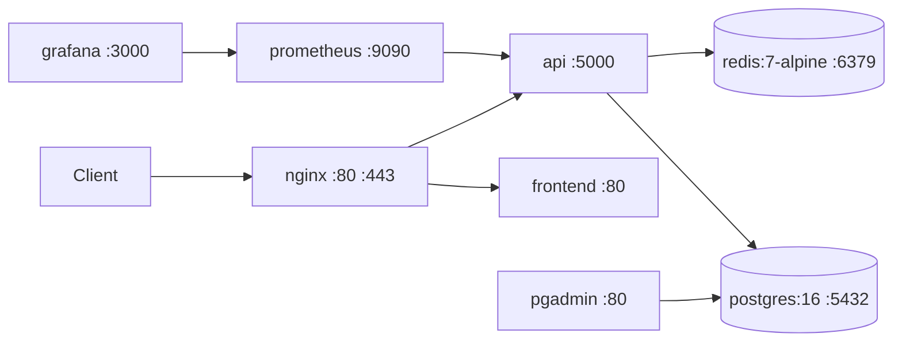

import { Callout } from 'nextra/components'

# Operations

Everything here is derived from committed infrastructure: `docker-compose.yml`,
`DockerFile.backend`, `DockerFile.frontend`, `nginx.conf`, `config/redis.conf`,
`monitoring/`, `drizzle.config.ts` and `.github/workflows/`. Nothing about a hosted
environment is asserted — the repository contains no deployment target, DNS name or
address registry.

## Topology



Only `nginx` publishes ports (`80`, `443`). Every other service uses `expose`, so it is
reachable on the `mtaadao-network` bridge but not from the host.

| Service | Image / build | Restart | Depends on |
| --- | --- | --- | --- |
| `api` | `DockerFile.backend` | `always` | `db` (healthy), `redis` (started) |
| `frontend` | `DockerFile.frontend` | `always` | `api` (healthy) |
| `nginx` | `nginx:alpine` | `always` | `frontend`, `api` |
| `db` | `postgres:16` | `always` | — |
| `redis` | `redis:7-alpine` | `unless-stopped` | — |
| `pgadmin` | `dpage/pgadmin4` | `always` | `db` (healthy) |
| `prometheus` | `prom/prometheus:latest` | `always` | — |
| `grafana` | `grafana/grafana:latest` | `always` | `prometheus` |

Volumes: `pgdata`, `redis-data`, `prometheus-data`, `grafana-data`. All services log to
`json-file` with `max-size 100m`, `max-file 10`.

## Configuration expected at deploy time

`docker-compose.yml` reads `.env.production` for the API and requires these variables in
the shell environment for interpolation:

| Variable | Used by | Notes |
| --- | --- | --- |
| `DB_NAME`, `DB_USER`, `DB_PASSWORD` | `db`, and the API's `DATABASE_URL` | No defaults — compose fails or substitutes empty strings if unset |
| `PGADMIN_EMAIL` | `pgadmin` | Defaults to `admin@mtaadao.org` |
| `PGADMIN_PASSWORD` | `pgadmin` | No default |
| `GRAFANA_USER` | `grafana` | Defaults to `admin` |
| `GRAFANA_PASSWORD` | `grafana` | No default |

The API's full variable surface is documented separately in
[Environment variables](/reference/environment). `NODE_ENV=production` triggers a fail-fast
check requiring `DATABASE_URL`, `SESSION_SECRET`, `JWT_SECRET`, `JWT_REFRESH_SECRET`,
`ENCRYPTION_KEY`, `ENCRYPTION_SALT` and `WALLET_PRIVATE_KEY`.

<Callout type="warning">
  **Security Gap / Recommended Control.** `pgadmin`, `prometheus` and `grafana` are on the
  same bridge network as the API and are not fronted by Nginx or any authenticating proxy.
  They are unreachable from outside only because they use `expose` rather than `ports` —
  publish nothing for them, and keep the host's Docker network off untrusted interfaces.
</Callout>

## Nginx

`nginx.conf` (mounted read-only) terminates on `:80` for `server_name localhost` and proxies:

| Location | Upstream |
| --- | --- |
| `/` | `frontend:80`, with `try_files $uri $uri/ /index.html` for SPA routing |
| `/api/` | `api:5000`, with `Upgrade`/`Connection: upgrade` headers for WebSockets |
| `/metrics` | `api:5000/metrics` |
| `= /health` | `api:5000/health` |

The compose file also mounts `./certs` into the container for TLS. **That directory is not
in the repository** — create and populate it before bringing the stack up, or `nginx` will
fail to mount. The committed `nginx.conf` listens on `:80` only; `nginx.conf.prod` contains
the TLS variant.

<Callout type="error">
  **`nginx.conf` as committed will not start.** The file is 101 lines containing *two*
  complete configurations concatenated: an `events` + `http` block ending at line 53, then a
  second `events` + `http` block from line 54. Nginx rejects a duplicate `events` directive
  at parse time, so the container exits on boot.

  The two halves also disagree: the first proxies to `api:5000` and has no `/ws` block; the
  second adds `location /ws` with upgrade headers but points `upstream api` at `api:4000`,
  which nothing listens on. Reconcile into a single block — first half's port, second half's
  `/ws` location — before deploying. The tables above describe the first block, which is the
  one whose upstream port is correct.
</Callout>

## Health checks

| Check | Target | Notes |
| --- | --- | --- |
| `api` | `curl -f http://localhost:5000/health` every 30s, 40s start period | See caveat below |
| `nginx` | `wget --spider http://localhost/health` | Proxies to the API |
| `db` | `pg_isready -U $DB_USER` every 10s | |
| `redis` | none defined | Compose only waits for `service_started` |

<Callout type="warning">
  `/health` is a `301` redirect to `/api/health`. `curl -f` does not follow redirects and
  does not treat `3xx` as failure, so the API healthcheck passes as soon as the HTTP server
  answers — even if the application is unhealthy. Use `/api/health/live` for liveness and
  `/api/health/ready` for readiness instead.
</Callout>

Application health endpoints (`server/routes/health.ts`, mounted at `/api/health`):

| Path | Auth |
| --- | --- |
| `GET /api/health` | public |
| `GET /api/health/live` | public — liveness |
| `GET /api/health/ready` | public — readiness |
| `GET /api/health/detailed` | authenticated |
| `GET /api/health/system`, `/operational`, `/subsystems`, `/registry`, `/redis`, `/morio`, `/dex`, `/propagation`, `/metrics`, `/metrics/prometheus` | `super_admin` |

## Metrics and monitoring

`GET /metrics` (Prometheus text) and `GET /metrics/json` are guarded by `metricsAuth`:

1. If `METRICS_IP_ALLOWLIST` (comma-separated) contains the client IP — taken from the
   first `X-Forwarded-For` entry when present — the request is allowed with no token.
2. Otherwise a token must match `METRICS_AUTH_TOKEN` (or `METRICS_COOKIE_TOKEN`), supplied
   as `Authorization: Bearer`, `X-Metrics-Token`, or a `metrics_token` cookie. Comparison is
   timing-safe.
3. If no expected token is configured, the request is denied (`401`) — it fails closed.

<Callout type="warning">
  **Security Gap / Recommended Control.** The IP allow-list trusts `X-Forwarded-For`
  unconditionally, so a client that can reach the API directly can spoof an allow-listed
  address and bypass the token. Only run with `METRICS_IP_ALLOWLIST` set when the API is
  reachable exclusively through a proxy that overwrites that header.
</Callout>

Prometheus (`monitoring/prometheus.yml`) scrapes at a 15s global interval with rules from
`monitoring/prometheus-rules.yml`; Grafana provisioning lives in
`monitoring/grafana/provisioning`.

<Callout type="warning">
  The `mtaadao-api` scrape job targets `api:4000`, but the API container listens on `5000`
  (`PORT: 5000`, `expose: 5000`, `EXPOSE 5000`). As committed, Prometheus will not scrape
  the API.
</Callout>

## Redis

`config/redis.conf` is mounted read-only and passed explicitly as the server config.
Persistence is on: RDB snapshots (`900/1`, `300/10`, `60/10000`) plus AOF with
`appendfsync everysec`, into the `redis-data` volume. `maxmemory 512mb` with
`allkeys-lru` eviction.

<Callout type="warning">
  **Security Gap / Recommended Control.** The config sets `bind 0.0.0.0` and no
  `requirepass`, so Redis accepts unauthenticated connections from anything on the Docker
  network. `protected-mode yes` does not help once a bind address is set. Note that
  `allkeys-lru` also means rate-limit counters and cached prices can be evicted under
  memory pressure.
</Callout>

## Database and migrations

Drizzle is configured in `drizzle.config.ts`: schema `./shared/schema.ts`, output
`./migrations`, dialect `postgresql`, with SSL relaxed automatically for Neon URLs.

```bash
npm run db:push     # drizzle-kit push — sync schema to DATABASE_URL
npm run migrate     # identical to db:push
```

<Callout type="warning">
  Both `db:push` and `migrate` run `drizzle-kit push`, which applies the schema directly
  rather than running the SQL files in `migrations/`. There is no versioned
  `drizzle-kit migrate` step wired up, and no seed script. Treat `migrations/*.sql` as a
  historical record, not as the applied path.
</Callout>

## Build and run

```bash
npm run build            # vite build + tsup backend bundle
npm run start:prod       # NODE_ENV=production node server/dist/index.js
docker compose up -d     # full stack
```

The backend image is a two-stage `node:20-bullseye-slim` build: `npm ci` → `npm run
build:backend` → runtime stage with production dependencies, `server/dist`, and `curl`
installed for the healthcheck.

## CI

| Workflow | Trigger | Steps |
| --- | --- | --- |
| `ci.yml` | push / PR to `main` | Node 20 → `npm ci` → `npm run lint` → `npm run check` → `npm test` → `npm run build`, then a Docker build-and-push job |
| `deploy.yml` | after CI completes | Deploys to a production server over SSH |
| `deploy-docs.yml` | push to `main` touching `mtaa-dao-whitepaper/**` | mdBook + `cargo doc` → GitHub Pages |
| `ci-cd.yml` | — | A second, larger pipeline (tests, security audit, staging/production deploy to Replit) |

<Callout type="warning">
  `ci-cd.yml` invokes `npm run db:migrate`, `type-check`, `test:unit`, `test:integration`
  and `test:e2e`. **None of those scripts exist** in `package.json` (the real names are
  `migrate`/`db:push`, `check`, and `test`). That pipeline cannot pass as written; `ci.yml`
  is the one that matches the repository.

  Separately, `deploy-docs.yml` publishes the mdBook whitepaper — **not** this Nextra site.
  No workflow builds or deploys `docs-site/`.
</Callout>

## Backups and recovery

No backup, restore or disaster-recovery automation is committed. Postgres data lives in the
`pgdata` volume and Redis in `redis-data`; both must be backed up by external tooling.

<Callout type="info">
  **Security Gap / Recommended Control** — add scheduled `pg_dump` (or a managed-Postgres
  backup policy), verify restores, and document an RPO/RTO. Nothing in the repository
  currently provides one, and this documentation will not invent numbers.
</Callout>

## Production checklist

Derived from what the code actually enforces or requires:

- [ ] `.env.production` present, with the seven production-required secrets set to non-default values
- [ ] `DB_NAME` / `DB_USER` / `DB_PASSWORD`, `PGADMIN_PASSWORD`, `GRAFANA_PASSWORD` exported
- [ ] `./certs` populated and the TLS-capable Nginx config mounted
- [ ] `METRICS_AUTH_TOKEN` set (metrics fail closed without it)
- [ ] `GATEWAY_MODE` set deliberately — it defaults to `live`
- [ ] Redis `requirepass` set, or the network otherwise restricted
- [ ] Prometheus scrape target corrected to port `5000`
- [ ] Container healthchecks pointed at `/api/health/live` / `/api/health/ready`
- [ ] Schema applied via `npm run db:push` against the production `DATABASE_URL`
- [ ] Backups configured for `pgdata`
